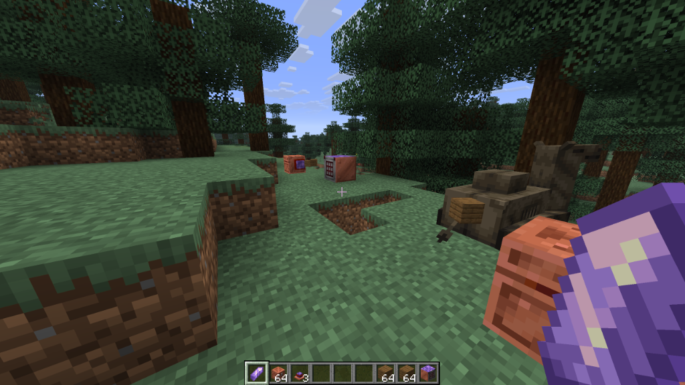
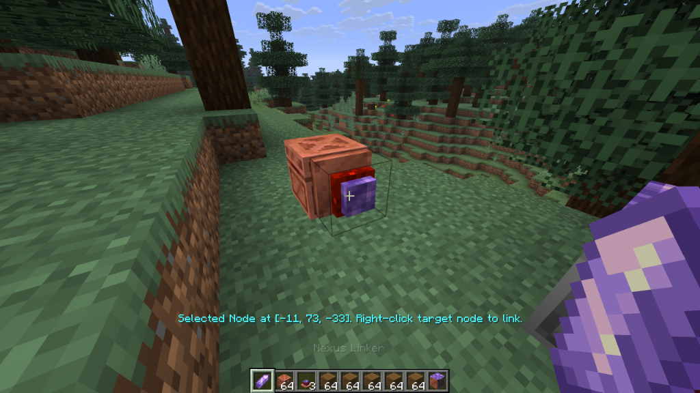
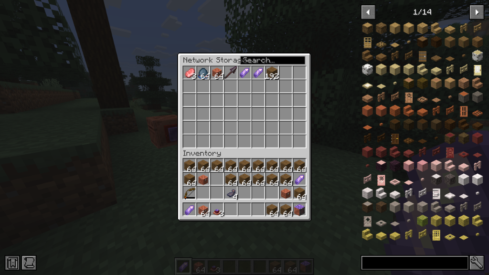
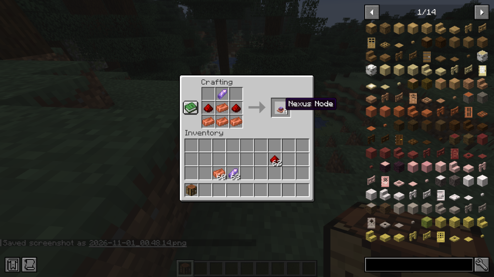
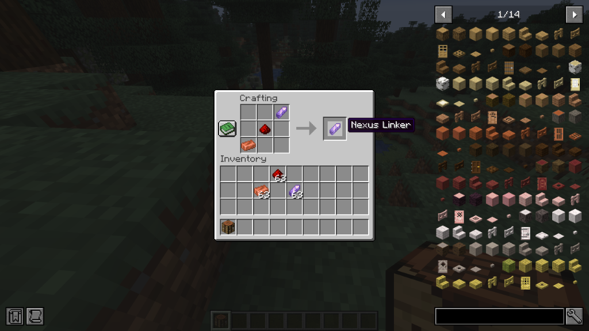
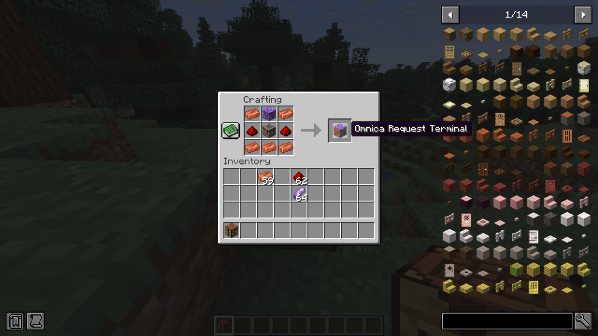
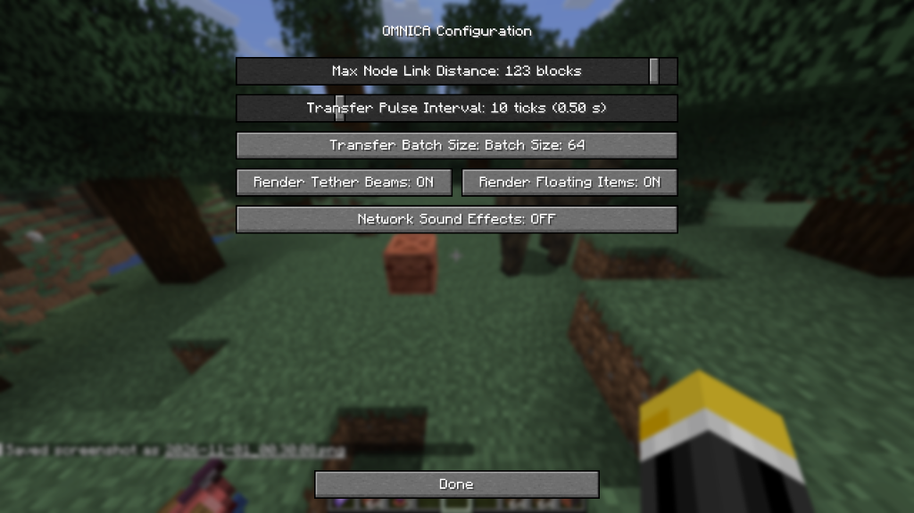

# OMNICA

[](https://minecraft.net/)
[](https://fabricmc.net/)
[](https://adoptium.net/)
[](https://github.com/Bomberrie)
[](https://opensource.org/licenses/MIT)

**A vanilla-aligned item logistics and wireless storage network mod for Minecraft.**

OMNICA implements a graph-based logistics engine that routes items across container inventories using Fabric's native Transfer API. Utilizing vanilla materials (Copper, Amethyst, Redstone, and Crafters), the mod establishes directed node networks that transfer item stacks without hopper polling overhead, physical entity pipelines, or external energy systems.



---

## System Overview & Performance

OMNICA replaces standard hopper lines and dropper towers with deterministic node-to-node routing:

- **Optimized Throughput**: Traditional hoppers execute continuous bounding-box entity checks and inventory polling every game tick. OMNICA computes item routing on fixed tick intervals using transaction-safe Fabric Transfer API (`Storage<ItemVariant>`) operations, maintaining consistent tick rates in complex networks.
- **Vanilla Integration**: Requires zero custom worldgen ores or external energy currencies (RF/FE). All components are fabricated exclusively from vanilla materials.
- **In-World Visualization**: Transfers render via dynamic 3D double-sided luminous laser tethers and interpolated item flight paths along vector trajectories.
- **Modern Compatibility**: Engineered for **Minecraft 26.3 ("Wilderness Bound")** and **Java 25**, fully leveraging container components such as **Bundles** and the **Crafter**.

---

## Network Components & Mechanics

### 1. Nexus Node
The primary endpoint block placed directly on container surfaces (Chests, Double Chests, Barrels, Crafters, and Droppers).

#### Routing Modes
Interact with a placed node using an empty hand to cycle operating modes:
- **Extractor (Cyan)**: Pulls items from the attached inventory and injects them into connected network paths.
- **Inserter (Purple)**: Accepts routed items from the network and inserts them into the attached inventory.
- **Balanced (Gold)**: Bidirectional mode that equalizes item distributions across connected nodes.

#### Filtering Pipeline
- **Single Item Filter**: Right-click the node with any item stack to restrict operations exclusively to that item type.
- **Bundle Multi-Filter (Up to 64 items)**: Right-click the node with a filled vanilla **Bundle**. The node decodes the bundle container component to whitelist all contained item variants simultaneously.
- **Clear Filter**: Sneak-right-click with an empty hand while in Balanced mode to clear all assigned filter entries.

---

### 2. Nexus Linker
A configuration tool used to establish and modify network topology.
- **Establishing Connections**: Right-click an initial Nexus Node to select its coordinates, then right-click a target node (up to the configured maximum distance, default 32 blocks) to establish a bidirectional tether.
- **Clear Selection**: Sneak-right-click in the air or interact with the currently selected node to cancel linking.
- **Network Topology**: Nodes support multi-connection branching, allowing the creation of complex mesh or tree network topologies across bases.



---

### 3. Request Terminal
The central user interface for network-wide inventory querying and extraction.
- **Placement**: Place adjacent to any existing Nexus Node on the network.
- **Search Pipeline**: Provides instant case-insensitive substring searching across all aggregated network inventories.
- **Extraction Protocol**: Left-click any indexed item stack to dispatch an extraction transaction directly into player inventory slots.



---

## Crafting Recipes

All components are crafted using standard vanilla recipes.

### Nexus Node (Yields 4x)
Crafted at a Crafting Table with Copper Ingots, Amethyst Shard, and Redstone Dust:



```
[       ] [ Amethyst Shard ] [       ]
[Redstone] [  Copper Ingot  ] [Redstone]
[ Copper ] [  Copper Ingot  ] [ Copper ]
```
- **Ingredients**: 1 Amethyst Shard, 2 Redstone Dust, 5 Copper Ingots
- **Yield**: **4x Nexus Nodes**

---

### Nexus Linker (Yields 1x)
Crafted as a tuning implement:



```
[       ] [       ] [ Amethyst Shard ]
[       ] [Redstone] [       ]
[ Copper ] [       ] [       ]
```
- **Ingredients**: 1 Amethyst Shard, 1 Redstone Dust, 1 Copper Ingot
- **Yield**: **1x Nexus Linker**

---

### Omnica Request Terminal (Yields 1x)
Constructed using an Amethyst Block, a Crafter, Redstone Dust, and Copper Ingots:



```
[ Copper ] [ Amethyst Block ] [ Copper ]
[Redstone] [     Crafter    ] [Redstone]
[ Copper ] [  Copper Ingot  ] [ Copper ]
```
- **Ingredients**: 1 Amethyst Block, 1 Vanilla Crafter, 2 Redstone Dust, 5 Copper Ingots
- **Yield**: **1x Omnica Request Terminal**

---

## Configuration

When **Mod Menu** is installed, options can be configured via the client interface (**Mods** -> **OMNICA** -> **Configure**).



Configuration parameters are persisted to `config/omnica.json`:

| Setting | Default | Range | Description |
| :--- | :---: | :---: | :--- |
| **Max Link Distance** | `32` | `8 - 128 blocks` | Maximum distance allowed between two linked nodes. |
| **Transfer Interval** | `8 ticks` | `1 - 40 ticks` | Execution interval for network transfer pulses (8 ticks = 0.4s). |
| **Batch Size** | `64 items` | `1 - 64` | Maximum item stack count moved per transfer pulse. |
| **Render Tether Beams** | `ON` | `ON / OFF` | Controls rendering of 3D luminous laser tethers between nodes. |
| **Render Floating Items** | `ON` | `ON / OFF` | Controls rendering of traveling item entities along network paths. |
| **Network Sound Effects** | `ON` | `ON / OFF` | Controls audio playback during network transfer events. |

---

## Build & Development

OMNICA uses Gradle with Fabric Loom for compilation and environment orchestration.

### Prerequisites
- **Java Development Kit (JDK) 25** (recommended: [Eclipse Adoptium Temurin 25](https://adoptium.net/))
- **Fabric Loader 0.20.1+**
- **Fabric API 0.165.0+26.3**

### Build Commands

```bash
# Clone the repository
git clone https://github.com/Bomberrie/omnica.git
cd omnica

# Compile and package the mod jar
./gradlew build
```
Compiled binaries are output to:
```
build/libs/omnica-0.1.0-alpha.jar
```

### Development Environments

```bash
# Launch test Minecraft client
./gradlew runClient

# Launch headless dedicated test server
./gradlew runServer
```

---

## Credits & Authorship

- **Author & Maintainer**: **[Bomberrie](https://github.com/Bomberrie)**
- **Routing Engine**: Implemented via Fabric Transfer API and transaction primitives.
- **Rendering Pipeline**: Developed with custom double-sided prism shaders and Minecraft 26.3 GuiRenderState.

---

## License

OMNICA is released under the open-source **[MIT License](LICENSE)**.
